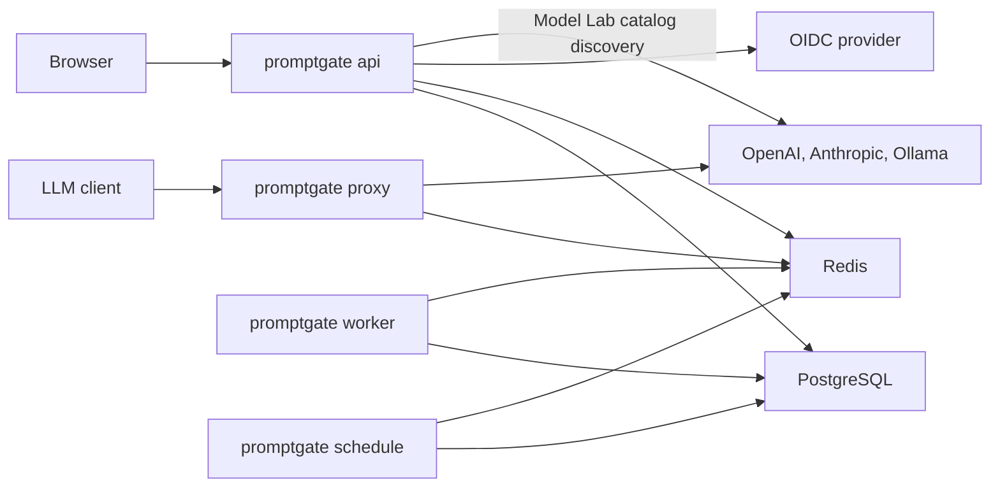
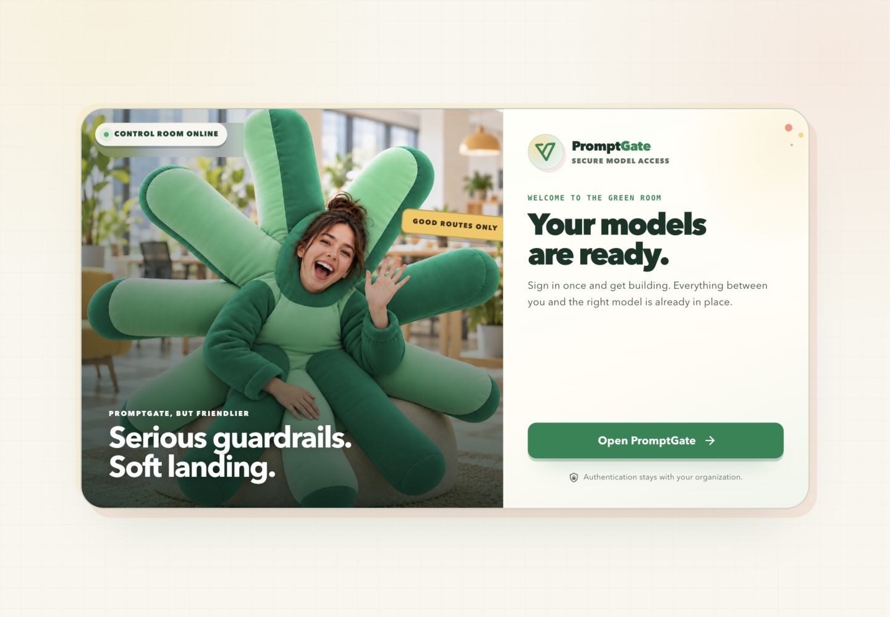
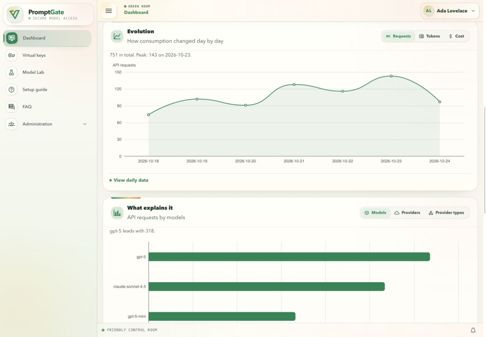
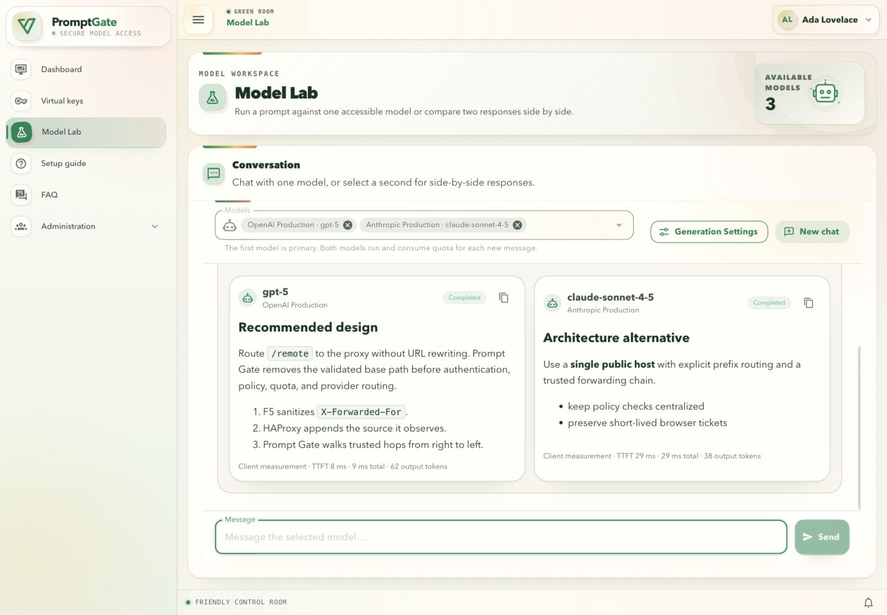
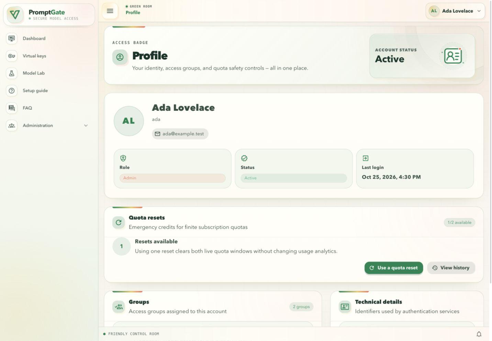
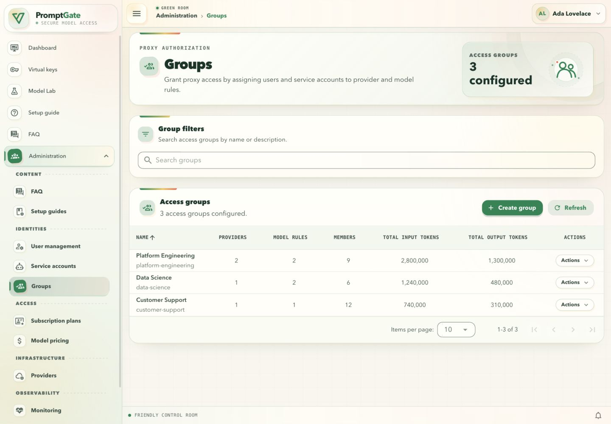
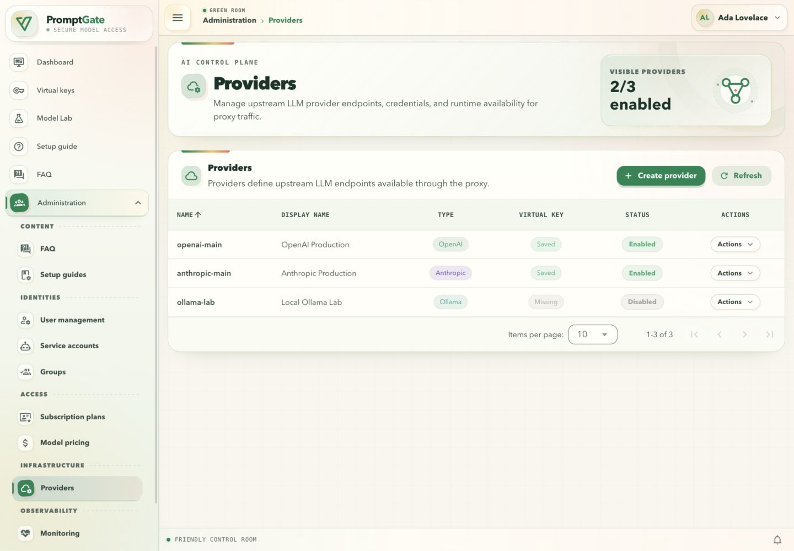

# Prompt Gate


Prompt Gate is the Go service layer for Prompt Gate, a control plane
for safely exposing LLM providers to teams. It combines browser login, role
management, API token issuance, a provider-aware LLM proxy,
external OPA policy checks, usage recording, quota enforcement, and scheduled
maintenance jobs. An optional durable SMTP outbox notifies users about
onboarding, quotas, reset credits, access groups, virtual keys, and monthly
usage while exposing delivery operations to administrators.

Model Lab is a chat-first workspace backed by the group-filtered model catalog.
Users can run one model or select a second model for a side-by-side response;
only the primary response continues into the next turn. Short-lived,
single-use browser tickets keep every run on the existing OPA, group, quota,
provider, and accounting path. Prompt and response content is excluded from
Prompt Gate persistence and telemetry for these runs.

Personal and administrator dashboards combine live quota state with durable
usage aggregates, provider and model breakdowns, cost coverage, and rankings of
the tools reported by model responses.

The product is designed as a small set of deployable processes built from one
binary:

- `api` runs the HTTP API, OIDC login flow, admin endpoints, and
  optional static frontend hosting.
- `proxy` runs the LLM proxy that validates Prompt Gate API tokens or Model Lab
  tickets, evaluates external OPA policy, routes to configured providers, and
  enqueues usage.
- `worker` consumes proxy usage events, stores raw operational usage data, and
  updates dashboard KPI aggregates.
- `schedule` runs recurring background jobs, including raw usage cleanup,
  monthly quota-reset credits, pending-reset reconciliation, and quota-state
  projection.
- `migrate` applies database schema migrations.

## Quick Start

The fastest local path is Docker Compose. It starts PostgreSQL, Redis,
Keycloak, migrations, the API, the proxy, the worker, the scheduler, and a seeded
local Ollama provider.

```sh
docker compose up --build
```

Open the application at `http://localhost:8080`.

Useful local credentials:

- Keycloak admin console: `http://keycloak.localhost:8082`
- Keycloak admin user: `admin` / `admin`
- Prompt Gate test user: `admin` / `admin`

For source-based development:

```sh
cp promptgate.example.yaml promptgate.yaml
make deps
make test
make migrate
make run-api
make run-proxy
make run-worker
make run-schedule
```

Or run all backend processes from one terminal:

```sh
make run-all
```

## Requirements

- Go 1.26.x
- Node.js 24 for frontend asset builds
- PostgreSQL
- Redis
- Keycloak or another OIDC-compatible identity provider
- Docker for container builds and local Compose

## Main Commands

```sh
make deps        # download Go modules
make fmt         # format Go files
make fmt-check   # verify Go formatting
make vet         # run go vet
make staticcheck # run Staticcheck
make test        # run backend tests
make build       # build bin/promptgate
make clean       # remove local binaries
```

The Docker image builds one binary at `/app/promptgate` and exposes:

- port `8080` for the API
- port `8081` for the proxy

The default container command starts the API:

```text
/app/promptgate --config /etc/prompt-gate/promptgate.yaml api
```

## Project Shape

Prompt Gate stores durable state, quota-reset wallets, and audit history in
PostgreSQL. Redis holds browser sessions, proxy auth caches, configuration
snapshots, live quota windows, and hot-reload events. Proxy usage events also
flow through Redis before workers persist them to PostgreSQL.
OIDC handles browser identity, while Prompt Gate API tokens authenticate proxy
traffic from applications and service accounts. Model Lab uses dedicated,
single-use proxy tickets rather than exposing a reusable API token to the
browser.



### External policy enforcement

Proxy requests, including Model Lab runs, are authorized by an external OPA
server. A deny-by-default Kubernetes example is available under
`deploy/examples/opa`. OPA is enabled by default and can be bypassed during an
access incident with `proxy.opa.enabled: false`; authentication, groups, and
quotas remain active.

## Screenshots

These screenshots were generated from the current frontend with deterministic,
fictional local data. They contain no production identity, token, provider
credential, prompt, or endpoint.

### User workspace

#### Sign in



The browser entry point explains the control-plane boundary before redirecting
through the configured OIDC provider.

#### Usage dashboard


Live five-hour and seven-day quota windows stay separate from the selected
reporting period and its request, token, tool-call, cost, and latency KPIs.



The lower cockpit continues from trends and model/provider breakdowns into
durable top tool-call rankings and the annual activity heatmap.

#### Model Lab



The ephemeral chat workspace runs one primary model or two selected models side
by side while preserving the normal policy, quota, and accounting controls.

#### Virtual keys


Personal virtual key inventory with status, creation dates, expiry dates, and
row actions.

#### Setup guide


Client setup flow for selecting providers, matching routes, and copying
ready-to-use snippets.

#### Profile and quota controls



The profile brings identity, access groups, token activity, live quota, and
available reset credits into one user-owned surface.

#### Quota reset history


The profile keeps an audit-friendly history of monthly grants, administrator
grants, and applied resets.

### Administration and operations

#### User management


The administrator directory shows access, state, subscription, recent activity,
and whether an account was pre-created before its first OIDC login.

#### Account actions


Account-scoped actions cover access, virtual keys, groups, usage, IP history,
notes, quota-reset credits, and deletion from a single menu.

#### Service accounts


Non-human identities have explicit status, plan, usage, group membership, and
integration-key controls.

#### Access groups



Groups connect users and service accounts to approved providers and model
patterns, including deny rules and validation before saving.

#### Providers



Provider administration keeps protocol type, base URL, status, model discovery,
and routing names visible without exposing stored credentials.

#### Monitoring


Operations view for reviewing HTTP/S service checks, current status, latest
latency, and incident-banner readiness.

#### API documentation


The protected Swagger UI is available from the user menu to every active role.
It reuses the current HttpOnly session, and every request remains subject to
that user's permissions.

## Documentation

Start with the documentation index, then jump into the area you are working on:

- [Documentation index](docs/README.md)
- [Architecture](docs/architecture.md)
- [API reference](docs/api.md)
- [Proxy runtime](docs/proxy.md)
- [Scheduler](docs/scheduler.md)
- [Security model](docs/security.md)
- [Development guide](docs/development.md)
- [Deployment guide](docs/deployment.md)
- [YAML configuration](docs/environment.md)
- [Release process](docs/release.md)
- [User FAQ](faq.md)

## Docker Image

Build the production image locally:

```sh
docker build -t prompt-gate-backend:test .
```

The image also builds the Nuxt frontend as static assets and serves them from
the API process when `api.static_assets_dir` points to `/app/public`.

Official release image:

```text
ghcr.io/thomas-illiet/prompt-gate
```

## CI And Releases

The `CI` workflow runs formatting, vet, Staticcheck, tests, backend build,
frontend lint, frontend typecheck, frontend tests, Compose validation, and a
Docker image build.

The `Release` workflow runs when a semver tag matching `vX.Y.Z` is pushed. It
publishes the Docker image to GitHub Container Registry and creates a GitHub
Release.
