# Prompt Gate

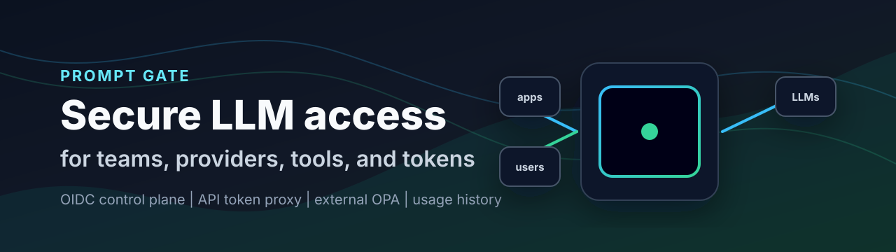

Prompt Gate is the Go service layer for Prompt Gate, a control plane
for safely exposing LLM providers to teams. It combines browser login, role
management, API token issuance, a provider-aware LLM proxy,
external OPA policy checks, usage recording, quota enforcement, and scheduled
maintenance jobs.

Model Lab provides a group-filtered model catalog and an ephemeral, text-only
multi-turn chat. A completed response can be compared on demand with up to two
alternative models. It uses short-lived, single-use browser tickets while
keeping every run on the existing OPA, group, quota, provider, and accounting
path. Prompt and response content is excluded from Prompt Gate persistence and
telemetry for these runs.

The product is designed as a small set of deployable processes built from one
binary:

- `api` runs the HTTP API, OIDC login flow, admin endpoints, and
  optional static frontend hosting.
- `proxy` runs the LLM proxy that validates Prompt Gate API tokens,
  evaluates external OPA policy, routes to configured providers, and enqueues usage.
- `worker` consumes proxy usage events, stores raw operational usage data, and
  updates dashboard KPI aggregates.
- `schedule` runs recurring background jobs, including raw usage cleanup,
  monthly quota-reset credits, pending-reset reconciliation, and quota-state
  projection.
- `migrate` applies database schema migrations.

## Quick Start

The fastest local path is Docker Compose. It starts PostgreSQL, Redis,
Keycloak, migrations, the API, the proxy, the worker, the scheduler, and a seeded
local Ollama provider.

```sh
docker compose up --build
```

Open the application at `http://localhost:8080`.

Useful local credentials:

- Keycloak admin console: `http://keycloak.localhost:8082`
- Keycloak admin user: `admin` / `admin`
- Prompt Gate test user: `admin` / `admin`

For source-based development:

```sh
cp .env.example .env
make deps
make test
make migrate
make run-api
make run-proxy
make run-worker
make run-schedule
```

Or run all backend processes from one terminal:

```sh
make run-all
```

## Requirements

- Go 1.26.x
- Node.js 24 for frontend asset builds
- PostgreSQL
- Redis
- Keycloak or another OIDC-compatible identity provider
- Docker for container builds and local Compose

## Main Commands

```sh
make deps        # download Go modules
make fmt         # format Go files
make fmt-check   # verify Go formatting
make vet         # run go vet
make staticcheck # run Staticcheck
make test        # run backend tests
make build       # build bin/promptgate
make clean       # remove local binaries
```

The Docker image builds one binary at `/app/promptgate` and exposes:

- port `8080` for the API
- port `8081` for the proxy

The default container command starts the API:

```text
/app/promptgate api
```

## Project Shape

Prompt Gate stores durable state, quota-reset wallets, and audit history in
PostgreSQL. Redis holds browser sessions, proxy auth caches, configuration
snapshots, live quota windows, and hot-reload events. Proxy usage events also
flow through Redis before workers persist them to PostgreSQL.
OIDC handles browser identity, while Prompt Gate API tokens authenticate proxy
traffic from applications and service accounts.

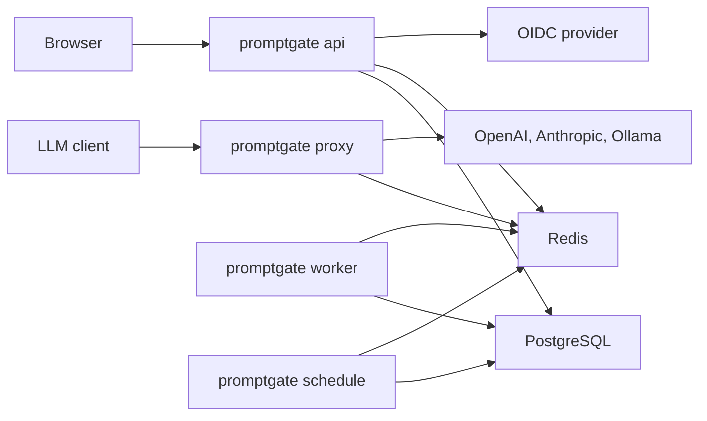

## Screenshots

These populated states use representative local data so the core product
surfaces are easier to review at a glance.

### Dashboard

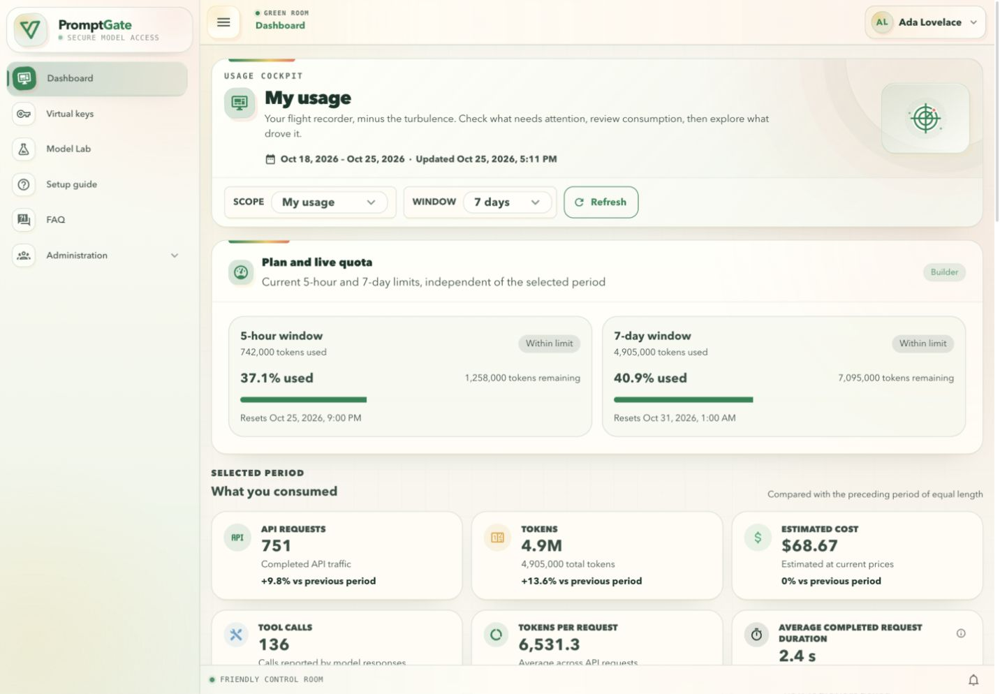

Live quota consumption, period-over-period KPIs, request and token trends, and
model/provider breakdowns.

### Virtual Keys

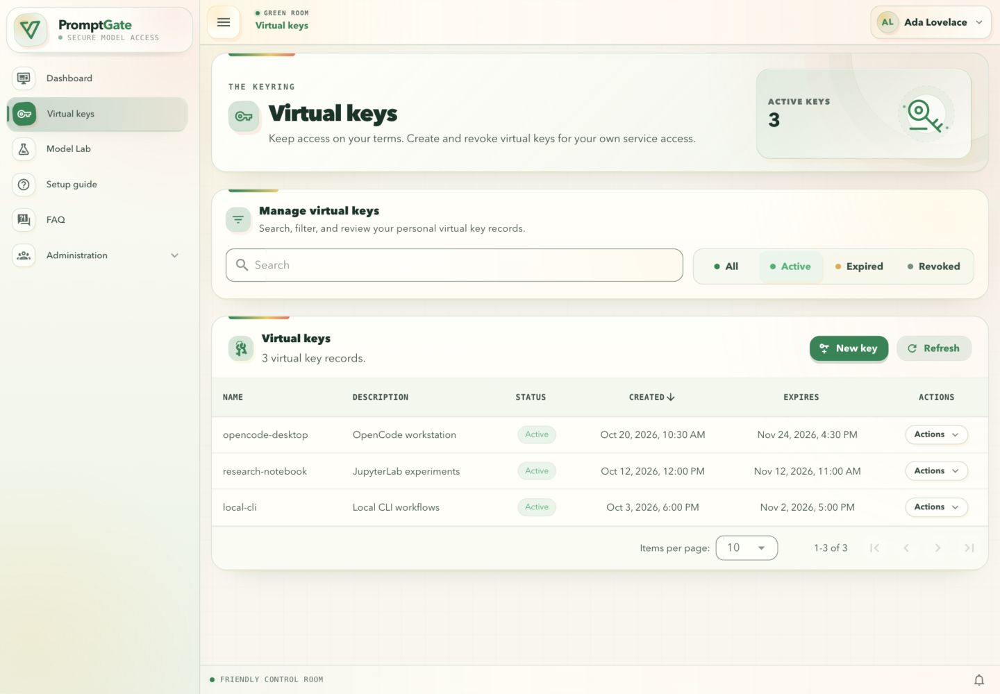

Personal virtual key inventory with status, creation dates, expiry dates, and
row actions.

### Setup Guide

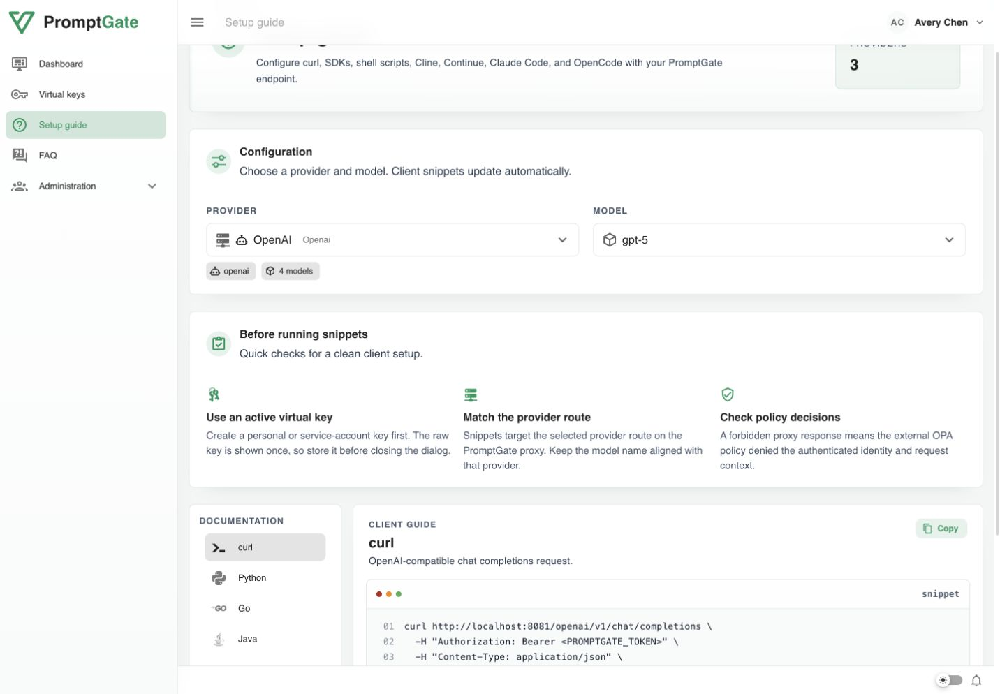

Client setup flow for selecting providers, matching routes, and copying
ready-to-use snippets.

### Service Accounts

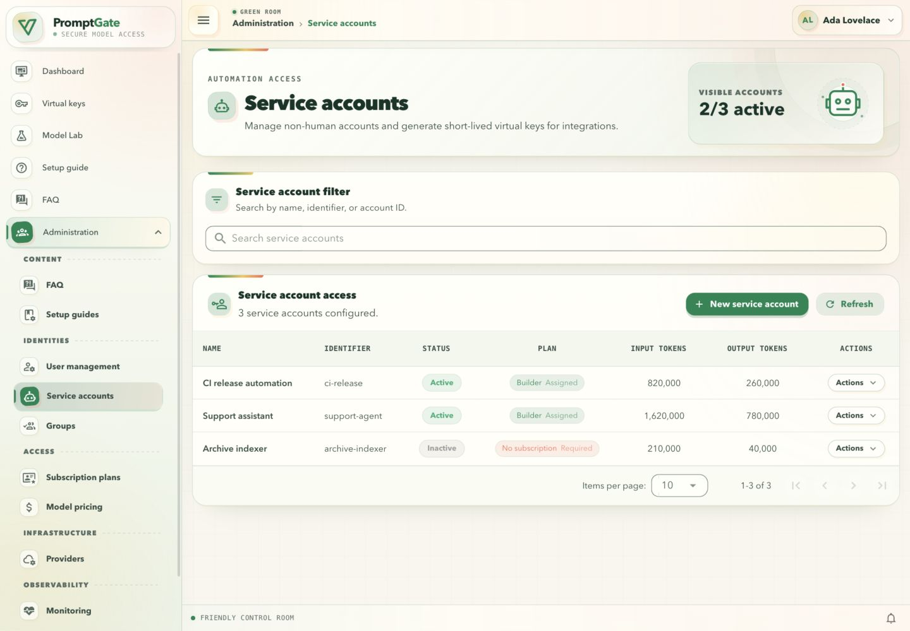

Non-human account management with activation status, usage totals, and
integration key actions.

### User Management

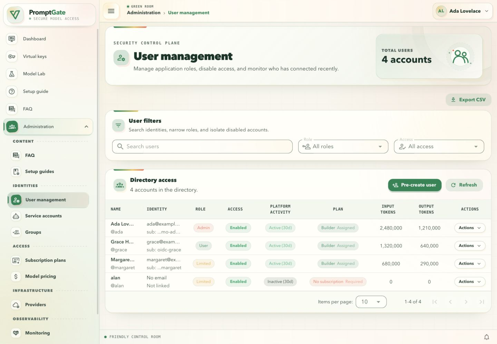

Admin directory view for reviewing access, active state, subscription plan,
30-day activity, pre-created accounts, and account-level actions.

### Administrator Account Actions

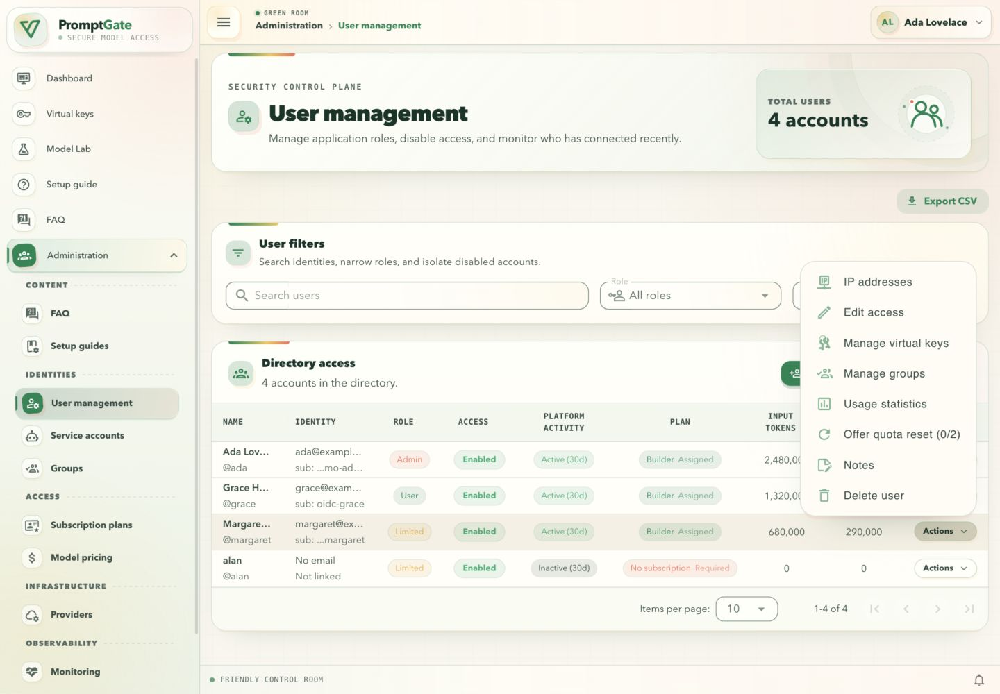

Centralized access to identity details, virtual keys, groups, usage statistics,
notes, deletion, and the audited quota-reset credit workflow.

### Quota Reset Credits

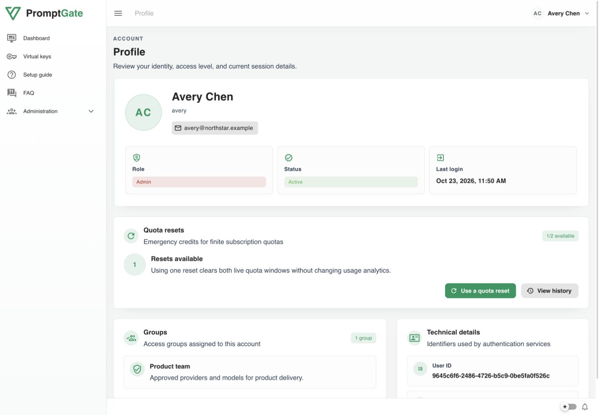

Users with a finite quota can spend an available credit to reset their live
5-hour and 7-day windows without erasing historical usage analytics.

### Quota Reset History

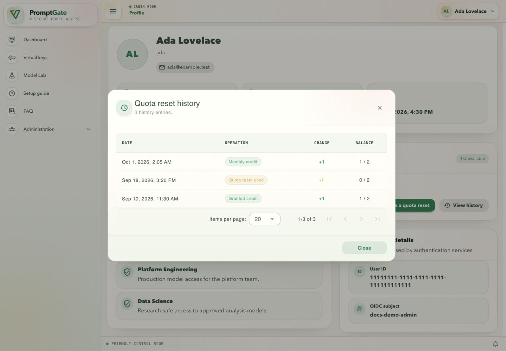

The profile keeps an audit-friendly history of monthly grants, administrator
grants, and applied resets.

### API Documentation

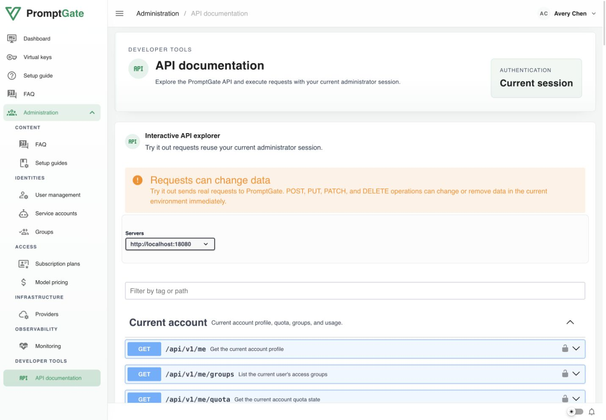

The protected Swagger UI reuses the current HttpOnly administrator session and
warns that mutating requests affect the live environment.

### External policy

Proxy requests are authorized by an external OPA server. A deny-by-default
Kubernetes example is available under `deploy/examples/opa`.
OPA is enabled by default and can be bypassed during an access incident with
`PROMPTGATE_OPA_ENABLED=false`; authentication, groups, and quotas remain active.

### Monitoring

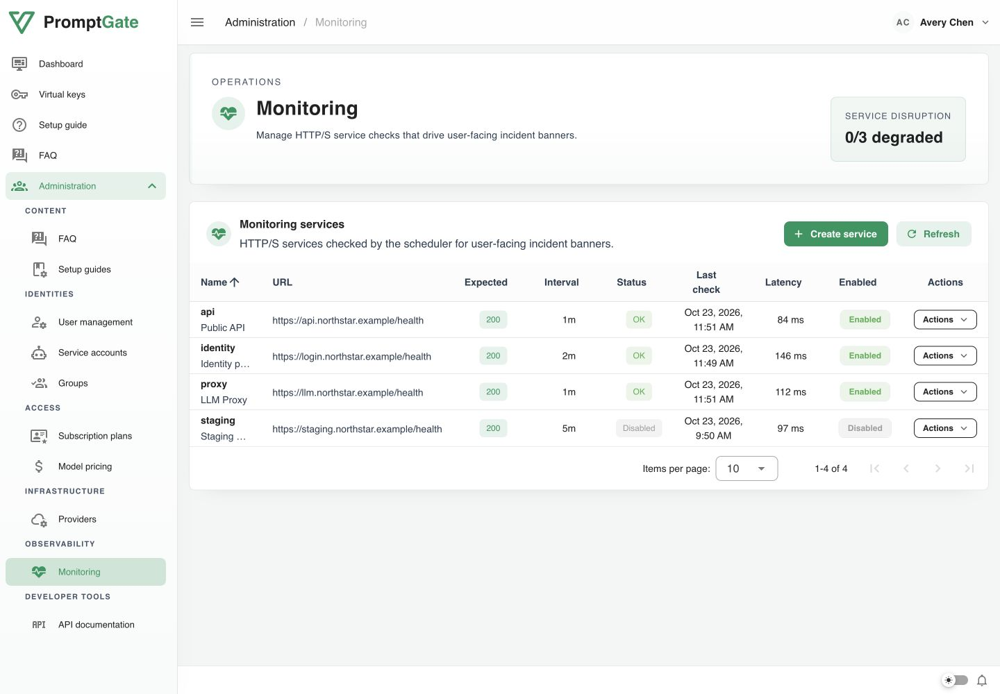

Operations view for reviewing HTTP/S service checks, current status, latest
latency, and incident-banner readiness.

## Documentation

Start with the documentation index, then jump into the area you are working on:

- [Documentation index](docs/README.md)
- [Architecture](docs/architecture.md)
- [API reference](docs/api.md)
- [Proxy runtime](docs/proxy.md)
- [Scheduler](docs/scheduler.md)
- [Security model](docs/security.md)
- [Development guide](docs/development.md)
- [Deployment guide](docs/deployment.md)
- [Environment variables](docs/environment.md)
- [Release process](docs/release.md)
- [User FAQ](faq.md)

## Docker Image

Build the production image locally:

```sh
docker build -t prompt-gate-backend:test .
```

The image also builds the Nuxt frontend as static assets and serves them from
the API process when `PROMPTGATE_STATIC_ASSETS_DIR` is set.

Official release image:

```text
ghcr.io/thomas-illiet/prompt-gate
```

## CI And Releases

The `CI` workflow runs formatting, vet, Staticcheck, tests, backend build,
frontend lint, frontend typecheck, frontend tests, Compose validation, and a
Docker image build.

The `Release` workflow runs when a semver tag matching `vX.Y.Z` is pushed. It
publishes the Docker image to GitHub Container Registry and creates a GitHub
Release.
