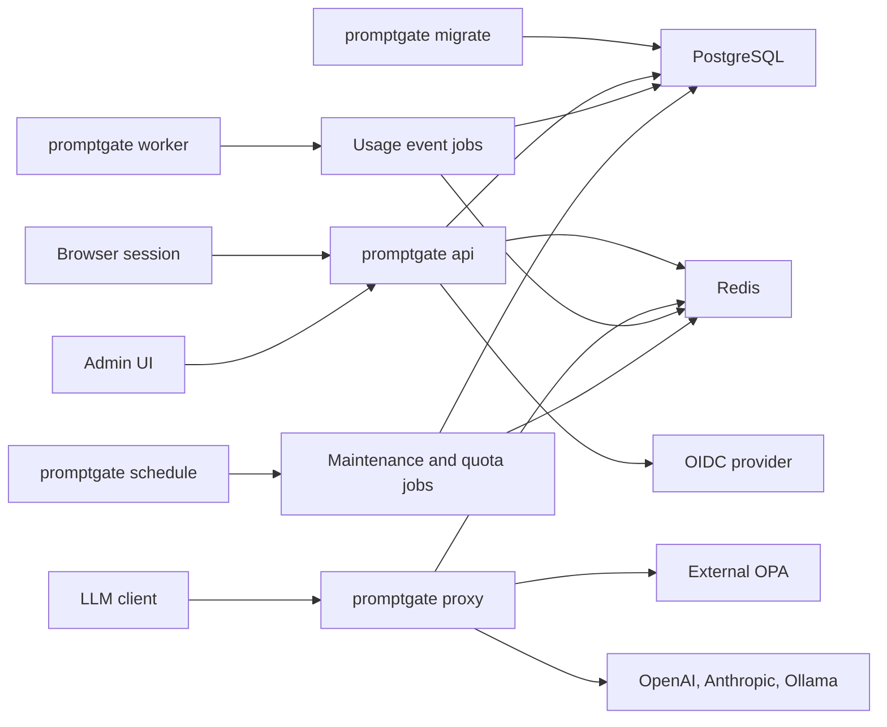
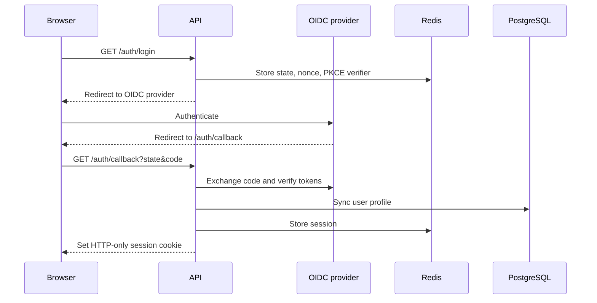
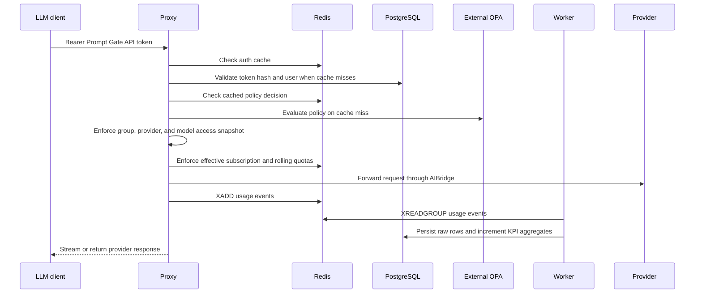
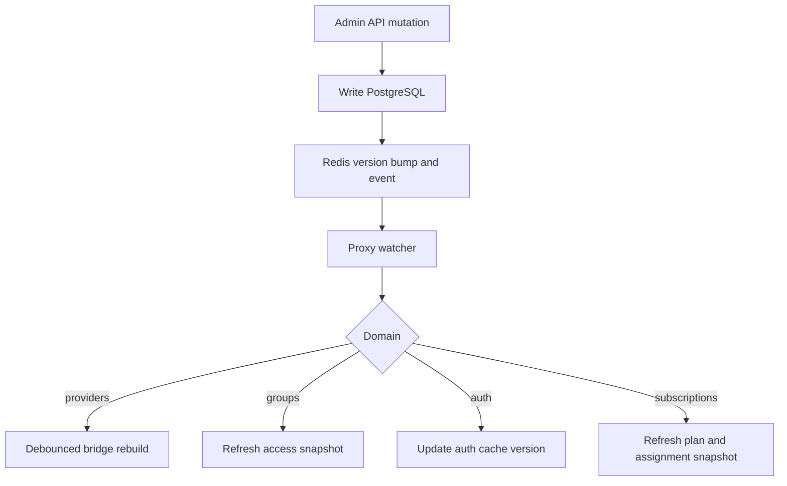

# Architecture

Prompt Gate Backend is a Go service layer split into five runtime commands from
one binary. Each command has a narrow operational responsibility and shares the
same domain packages.

## Runtime Components

| Command | Responsibility |
| --- | --- |
| `promptgate api` | HTTP API, OIDC browser login, sessions, user/admin routes, token creation, provider configuration, optional static frontend hosting. |
| `promptgate proxy` | API-token authentication for LLM traffic, external OPA authorization, provider routing, Redis usage event enqueueing, hot reload. |
| `promptgate worker` | Redis Stream consumer for proxy usage events, raw usage persistence, and dashboard KPI aggregation. |
| `promptgate schedule` | Background token and access expiration, monitoring checks, raw usage cleanup, quota projection, monthly reset-credit distribution, and pending-reset reconciliation. |
| `promptgate migrate` | Ordered migrations for all durable domain models, including subscription and quota-reset state, plus removal of retired schemas. |

## Package Layout

| Area | Main responsibility |
| --- | --- |
| `cmd/` | Cobra command tree and runtime bootstrapping. |
| `internal/runtime/app` | Shared application wiring for API and scheduler. |
| `internal/runtime/proxy` | AIBridge proxy manager, provider adapters, and hot reload. |
| `internal/domain/auth` | OIDC, sessions, roles, user profile context, proxy actor injection. |
| `internal/domain/tokens` | Prompt Gate API token creation, validation, revocation, cleanup, Redis auth cache. |
| `internal/domain/users` | Human users, service accounts, role management, access expiration. |
| `internal/domain/policy` | OPA client, Redis decision cache, policy middleware, and observability. |
| `internal/domain/provider` | LLM provider configuration, encrypted API keys, setup helper metadata. |
| `internal/domain/proxy` | Usage, tool, and interception recording plus dashboards. |
| `internal/domain/subscriptions` | Subscription plans, rolling quota enforcement, quota projections, and reset-credit wallets. |
| `internal/platform/*` | Configuration, Postgres, Redis, migrations, and secret encryption. |
| `internal/transport/httpapi` | HTTP routes and JSON handlers. |
| `internal/transport/httpapi/openapi` | OpenAPI source, protected document handler, and runtime/spec parity tests. |
| `internal/transport/httpmiddleware` | Session, CORS, authorization, and request logging middleware. |

## Data Stores

PostgreSQL is the source of truth for durable application data:

- users and service accounts
- Prompt Gate API token records and token hashes
- LLM provider definitions
- subscription plans and account assignments
- projected live quota state, quota-reset wallets, and the reset ledger
- proxy interceptions, token usage, and tool usage for operational metrics
- daily dashboard KPI aggregates and processed usage event ids

Redis is required by the current runtime configuration. It is used for:

- browser sessions and OIDC authorization requests
- proxy auth cache entries
- provider snapshots
- access-group and subscription-plan snapshots
- versioned subscription assignments and rolling 5-hour and 7-day quota state
- quota-reset sequence and cutoff barriers
- cached OPA allow and deny decisions
- config version counters and hot-reload events
- proxy usage event stream `promptgate:usage:events`

## Request Flows

### Browser API Flow

Protected API routes then use the session cookie, refresh the user profile from
the database, reject inactive or `none` users, and enforce route-level roles.

### Proxy Flow

The proxy removes `Authorization` and `X-Api-Key` before forwarding so Prompt
Gate credentials are not leaked to upstream providers.

## Configuration Reload

Configuration mutations publish Redis events on `promptgate:config:events`.
The proxy subscribes to those events and reacts without a process restart.

Provider updates trigger a debounced bridge rebuild. Group updates refresh the
proxy access snapshot. Auth updates bump the token auth cache version, which
invalidates old cache keys. A separate subscription watcher refreshes plan and
versioned assignment snapshots. OPA decisions expire only through
`PROMPTGATE_OPA_CACHE_TTL`.

## Migrations

`promptgate migrate` runs GORM migrations in dependency order:

1. users
2. subscriptions, quota projections, reset wallets, and reset events
3. tokens
4. FAQ entries
5. providers
6. setup guides
7. pricing
8. access groups
9. monitoring services
10. proxy recorder and dashboard KPI tables
11. destructive removal of retired firewall and MCP schemas

Run migrations before starting API, proxy, worker, or scheduler processes in a
new environment.
