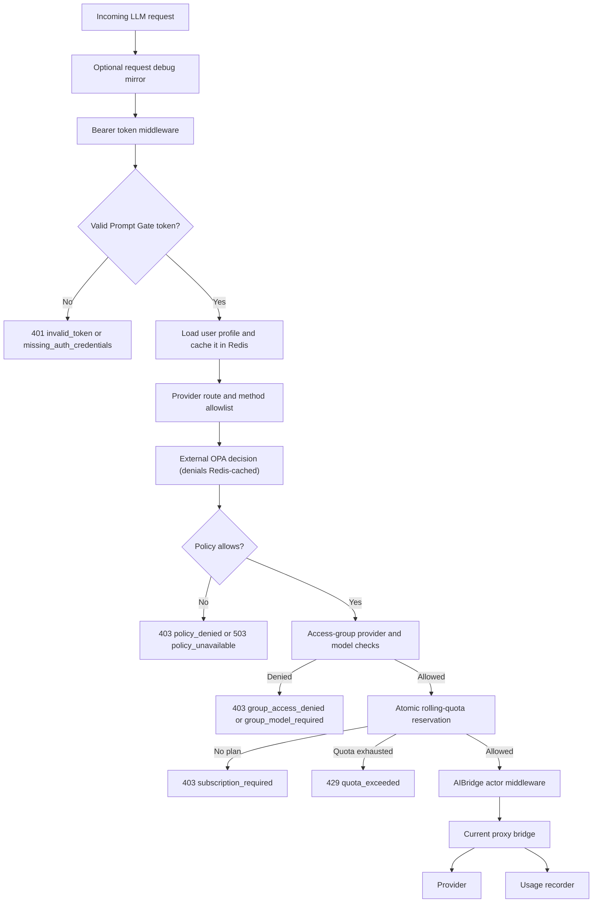

# Proxy Runtime

The proxy process is started with:

```sh
promptgate --config /path/to/promptgate.yaml proxy
```

It listens on `proxy.port`, defaults to port `8081`, and serves the
LLM proxy on `/`. It also exposes:

```text
GET /health
```

## Request Pipeline



The proxy rebuilds provider-bound headers from a strict allowlist after Prompt
Gate authentication. Prompt Gate credentials, cookies, forwarding headers,
tracing baggage, administration headers, and unknown custom headers are never
forwarded upstream.

Subscription checks apply to the exact `POST` routes for chat completions,
embeddings, Anthropic messages, and Responses API operations. Finite plans use
an atomic Redis reservation before provider dispatch, so concurrent requests
cannot all pass against the same remaining balance. The reservation combines a
conservative input/cache bound with the requested maximum output; an unbounded
request holds the remaining finite allowance until it completes. Observed
provider usage replaces the hold atomically. A successful provider response
without usage metadata consumes the conservative reservation. An explicit,
non-cancelled provider failure releases it; a client cancellation or deadline
after dispatch keeps the conservative charge because the provider may already
have accepted the request. Hosted/server-side tools whose injected context is
not bounded by the request body also reserve all remaining allowance. A quota
reset advances a per-account Redis barrier and
clears both live rolling windows without deleting PostgreSQL usage,
interception, or dashboard KPI data; in-flight reservations remain held because
their eventual usage is recorded after the reset barrier.

Streaming reservations remain held until the provider stream is complete.
Partial or aborted streams keep the conservative charge instead of reconciling
to an early input-only usage event. Prompt Gate also reads the final bounded
Responses API SSE usage event because the current AI Bridge does not emit that
usage callback when MCP is disabled.

Every provider POST body is parsed once with a strict, bounded JSON parser
before policy, quota, or upstream dispatch. Duplicate keys (including
Unicode/case-folded duplicates), non-object bodies, and malformed JSON are
rejected in linear time. Structural security fields are then matched
case-insensitively without imposing naming rules on arbitrary tool schemas or
business payloads. Prompt Gate also rejects provider-owned object handles that cannot be
attributed to the authenticated account: conversations, previous responses,
stored prompts, files/uploads, vector stores, remote media URLs, containers,
OpenAI encrypted reasoning/compaction items, and Anthropic thinking signatures
or redacted-thinking blobs. Provider-backed file search, MCP, image generation,
non-local shell state, provider-generated tool-result blocks, and unknown beta
input variants fail closed. Inline text/base64/data URLs and ordinary local
tool correlation IDs remain supported. This deliberately disables stateful
provider continuations until Prompt Gate has a per-account ownership registry
for them.

### Model Lab ticket path

The proxy recognizes Model Lab bearer tokens prefixed
with `pgml_`. These are dedicated, short-lived browser tickets, not regular
Prompt Gate API tokens. The proxy verifies their signature and exact method,
path, model, provider, protocol, account, expiry, and browser origin; validates
and canonicalizes the bounded text-only conversation history; then atomically
consumes the Redis record. Messages must alternate between `user` and
`assistant`, start with `user`, and end with the current `user` message. Replays
and expired tickets return the same generic `401`.
If `common.public_urls.proxy` contains a public routing prefix, configure the
same normalized path in `proxy.base_path`. The proxy removes it before ticket
validation, so the ticket remains bound to the canonical provider path while
the browser receives the prefixed public URL. The edge forwards the original
path unchanged and does not need a rewrite rule.

An account can hold at most `common.model_lab.max_concurrent` active Model
Lab leases. After ticket authentication, the request rejoins the canonical
client-IP, OPA, group, subscription/quota, AIBridge, provider, and accounting
pipeline. Each target therefore receives an independent authorization and
quota decision. Redis failure is fail-closed and no provider request is made.
Individual SSE frames and the cumulative stream are bounded; over-limit streams
end with a generic event before their rejected bytes can reach the browser.

## Request Debug Mode

Set `proxy.debug_requests: true` only for short-lived diagnostics. The
proxy then emits one JSON line to stdout for every incoming proxy request,
independently of `common.log.level`. Each event contains the timestamp,
`DEBUG` level, event type, method, scheme, host, path, raw query, protocol,
remote address, every incoming header value, and the request body bytes consumed
by the proxy. It does not drain an unread body solely for logging. JSON objects
and arrays are logged as structured JSON; other payloads are logged as raw
strings.

When `proxy.base_path` is configured, its validated prefix is removed before
this diagnostic runs, so the logged `path` is the canonical provider path. The
debug middleware otherwise remains first in the proxy pipeline, before
authentication and any header mutation. It mirrors reads without pre-consuming
or replacing the body stream. Its diagnostic copy is bounded by
`proxy.max_buffered_request_bytes`; only oversized requests include
`body_truncated: true`, and their normal processing or rejection is unchanged.
Responses are never logged.

Model Lab requests are an enforced exception to the content behavior above.
Once the `pgml_` prefix is recognized, debug output is reduced to method,
path, protocol, and `privacy_mode=metadata_only`. It omits the origin/host,
remote address, query, every header (including the ticket), and the body even
when debug mode is globally enabled. Client-IP diagnostics and AI Bridge
diagnostics are also suppressed for these requests.

**Warning:** this mode writes passwords, JWTs, cookies, provider keys, prompts,
and personal data to stdout in cleartext. Never leave it enabled in production,
and protect and delete collected logs according to your incident procedures.

## Provider Routing

Enabled providers are loaded from PostgreSQL or a Redis snapshot when the proxy
runtime starts. Supported provider types are:

- `openai`
- `anthropic`
- `ollama`

Provider API keys are stored encrypted with `common.security.secrets_key` and are
decrypted only when building the runtime provider client.

The setup helper returns these base URL patterns:

| Provider type | Client-facing proxy prefix |
| --- | --- |
| `openai` | `<proxy-base-url>/<provider-name>/v1` |
| `ollama` | `<proxy-base-url>/<provider-name>/v1` |
| `anthropic` | `<proxy-base-url>/<provider-name>` |

Provider names must be lowercase DNS-like names such as `openai-main` or
`local-ollama`.

## OPA policy behavior

The proxy evaluates an external OPA decision after token authentication and
before group, quota, and provider processing. Only denied decisions are cached
in Redis: every allow is re-evaluated so a policy revocation takes effect on the
next request without waiting for a cache TTL. OPA failures return
`503 policy_unavailable` on a cache miss; explicit policy denials return
`403 policy_denied`.

`proxy.opa.enabled` defaults to `true`. Setting it to `false` is an
emergency access-release mechanism: the proxy does not initialize or call OPA,
does not read its decision cache, and does not include OPA in `/health`.
Authentication, groups, quotas, and provider controls remain active. Disabling
OPA therefore fails open only for the external policy stage and emits a startup
warning; restore it to `true` as soon as the incident is resolved.

By default the proxy uses the TCP remote address. In production, prefer setting
`proxy.trusted_proxies` to the CIDRs of trusted ingress or reverse
proxy hops. The proxy will then trust `X-Forwarded-For` and `X-Real-IP` only
when the direct peer is in those CIDRs. All `X-Forwarded-For` occurrences are
processed from right to left: trusted intermediary hops are skipped and the
nearest untrusted address is selected. A malformed trusted chain falls back to
the TCP peer address.

For F5 -> HAProxy -> Prompt Gate, configure the narrow direct HAProxy peer range
and every controlled upstream hop that actually appears in the header chain.
The F5 must overwrite or sanitize the inbound header. With `forwarded-for`
enabled, HAProxy appends the TCP source it observes, which may be the F5 or a
node/SNAT address depending on the Kubernetes Service topology.

`proxy.trust_forward_headers: true` remains available as a legacy
global trust switch. Keep it disabled when `proxy.trusted_proxies` is
configured; enable it only behind an entirely trusted network boundary that
strips or rewrites every untrusted forwarded header.

For short-lived diagnosis, set `proxy.client_ip_debug: true`. Each
request then produces a structured `client IP resolved` log with only
`peer_ip`, `client_ip`, `source`, and `peer_trusted`. Raw forwarding headers,
request headers, paths, query strings, and bodies are not included. Disable it
after validating the trusted CIDR.

## Usage Recording

The proxy recorder stores:

- interception start and end timestamps
- initiating user or service account
- provider name and provider type
- model name
- token usage, including cache read/write token counts
- tool invocation names, arguments, and errors reported by providers
- the normalized client IP and its most recent use per user or service account

This data powers the current-user dashboard and user or service-account usage
totals. Prompt contents are never stored in PostgreSQL.

Usage events are injected into the `promptgate:usage:events` Redis Stream. When
the worker processes an `interception_started` event, it upserts the
`account_ip_addresses` row identified by the account and IP. `last_seen` only
moves forward, including when Redis retries or delivers older events later.
Requests rejected by authentication, OPA policy, group, or quota checks do not
create interceptions. Authenticated OPA denials still update the account IP
history with the latest denial reason and timestamp for that account and IP.
Allowed OPA decision reasons are not persisted.

Model Lab records keep only the accounting metadata needed by these same
controls: local account ID, provider/model, timestamps, token counts, cost,
status, and duration/TTFT when available. Prompt text, response text, thinking,
tool arguments, browser session IDs, names, email addresses, user agents, and
the raw ticket are not persisted or exported. The stored credential provenance
is the stable value `model_lab_ticket`, never a per-ticket identifier.

## Phoenix tracing

Set `proxy.otel.enabled: true` and configure
`proxy.otel.endpoint` to export spans using both OpenTelemetry GenAI and
OpenInference conventions to Phoenix over OTLP/HTTP. Traces contain the
provider, model, complete account identity, virtual-key ID and name, session,
token breakdowns, estimated cost, latency, tool calls, and errors. Provider
credentials, Prompt Gate JWTs, and token hashes are never attached to spans.

Prompt content requires the independent
`proxy.otel.capture_prompts: true` consent switch. When enabled, prompts
are exported in full without truncation or redaction. Model response text has
its own independent `proxy.otel.capture_output: true` consent switch. When
enabled, assistant text is exported in full as the OpenInference `output.value`
attribute; oversized responses are omitted rather than truncated. Provider-returned
thinking, reasoning summaries, and commentary require the separate
`proxy.otel.capture_thinking: true` switch and are exported in full as
OpenInference reasoning message content. Disabling
content capture does not make traces PII-free: textual
account identity and tool arguments are still exported. Telemetry failures are
fail-open and do not change proxy or quota behavior.

The per-request Model Lab metadata-only policy overrides all three global
content-capture switches. It drops Model Lab spans and AI Bridge diagnostic
logs, and suppresses prompt, output, thinking, tool, session, IP, and personal
identity content before Redis/PostgreSQL recorders, while retaining token and
cost accounting. Provider error bodies and streaming error events are replaced
with bounded generic errors before they reach the browser.

Attribute families remain deliberately distinct during the migration:

| Convention | Examples | Purpose |
| --- | --- | --- |
| OpenTelemetry GenAI / HTTP | `gen_ai.provider.name`, `gen_ai.operation.name`, `gen_ai.usage.*`, `url.path`, `error.type` | Vendor-neutral operation, usage, transport, and error semantics. |
| OpenInference | `openinference.span.kind`, `llm.*`, `input.value`, `tool.*`, `session.id` | Phoenix compatibility, prompt/tool representation, and cost attributes. |
| Prompt Gate | `promptgate.interception.id`, `promptgate.provider.name`, `promptgate.session.source`, `promptgate.credential.kind`, `promptgate.cost.estimated` | Product-specific identity, configuration, provenance, and internal correlations. |

`input.value` remains the OpenInference prompt representation. Prompt Gate does
not synthesize `gen_ai.input.messages` from raw text because the recorder does
not always know the missing message roles and parts. The
`promptgate.latency.time_to_first_byte_ms` measurement is also kept as a
product attribute: its clock does not start exactly when the provider request
is issued, so it is not equivalent to `gen_ai.response.time_to_first_chunk`.

### Native conversation correlation

Prompt Gate uses only conversation identifiers supplied by supported clients;
it never generates, prefixes, hashes, or otherwise rewrites them. Header names
are case-insensitive, values are trimmed at their boundaries, and invalid or
oversized values are ignored. The first valid header in this list wins:

| Priority | Header | Known client | Phoenix mapping |
| ---: | --- | --- | --- |
| 1 | `x-claude-code-session-id` | Claude Code | `session.id` |
| 2 | `x-openwebui-chat-id` | Open WebUI | `session.id` |
| 3 | `x-coder-chat-id` | Coder Agents | `session.id` |
| 4 | `x-kilocode-taskid` | Kilo Code | `session.id` |
| 5 | `x-client-session-id` | GitHub Copilot CLI | `session.id` |
| 6 | `x-interaction-id` | GitHub Copilot VS Code | `session.id` |
| 7 | `x-mux-workspace-id` | Mux | `session.id` |
| 8 | `x-session-id` | OpenCode | `session.id` |
| 9 | `x-session-affinity` | OpenCode | `session.id` |
| 10 | `session-id` | OpenCode OpenAI plugin | `session.id` |
| 11 | `session_id` | Codex/AIBridge | `session.id` |

The selected value is also exported as `gen_ai.conversation.id`, while
`promptgate.session.source` records the matching header name.
`x-parent-session-id` is exported separately as
`promptgate.parent_session.id`, and `x-openwebui-message-id` as
`promptgate.message.id`; neither can become the conversation identifier.

For example, OpenCode can send `x-session-id`, `x-session-affinity`, and
`x-parent-session-id`. Open WebUI can send `x-openwebui-chat-id` and
`x-openwebui-message-id`. Claude Code and Codex are accepted through their
native headers, with AIBridge's request-body extraction retained as a fallback
for Claude Code. A Langflow flow must map its existing `session_id` into a
supported provider header; Prompt Gate will not create one for it.

Incoming W3C `traceparent`, `tracestate`, and `baggage` fields are extracted to
preserve distributed trace ancestry. They represent trace propagation rather
than conversation identity: Prompt Gate never converts a trace ID or baggage
entry into `session.id`, and does not copy baggage entries into Phoenix span
attributes. The similarly named `Session-ID` from RFC 7989 is specific to SIP
and is not a generic HTTP session standard.

## Redis Cache And Snapshots

The proxy uses Redis for:

- API token auth cache keys
- provider snapshots
- access-group and subscription-plan snapshots
- versioned subscription assignments
- rolling 5-hour and 7-day quota counters plus quota-reset barriers
- OPA deny decisions
- config version counters
- config reload pub/sub
- asynchronous proxy usage and account IP events
- Model Lab catalog last-known-good entries, one-time ticket records, and
  per-account active-stream leases

`common.redis.cache_ttl` controls the default TTL for snapshots and cached
auth records. Cached auth entries also never outlive the token's expiration.
`proxy.opa.cache_ttl` independently controls cached-denial expiration.

## Hot Reload

The proxy subscribes to `promptgate:config:events`.

| Event domain | Proxy action |
| --- | --- |
| `providers` | Schedule a debounced bridge rebuild. |
| `groups` | Refresh the access-group snapshot. |
| `auth` | Update the auth cache version. |
| `subscriptions` | Refresh subscription plans and invalidate process-local assignment generations. |

`common.proxy_reload_debounce` controls provider rebuild debounce
time. Subscription updates use their own watcher but consume the same Redis
event stream. The proxy also listens for `SIGHUP` and runs a full runtime reload
when the signal is received.

Periodic DB-authoritative reconciliation repairs lost Redis notifications and
reconnects closed Pub/Sub subscriptions. If the database fails after a newer
provider or group generation is known, the proxy fails closed (provider bridge
unavailable or deny-all group snapshot) until an authoritative reload succeeds.
When no change is known, a transient database failure can retain the last
version-proven state. Each authoritative load has its own deadline so a database
blackhole cannot pin the reload lock indefinitely. Subscription assignments
also have a short independent lifetime, so a lost version bump is repaired by
a bounded per-user reload without scanning Redis or blocking unrelated quota
checks. Concurrent misses for the same account are coalesced into one database
lookup.

## Startup Requirements

The proxy requires `common.database.url`, `common.redis.url`,
`common.security.jwt_secret`, `common.security.secrets_key`, and
`common.public_urls.proxy`.

`proxy.opa.url` is additionally required when `proxy.opa.enabled: true` (the
default).

At least one supported enabled provider must exist before the proxy can build
its initial runtime bridge.
