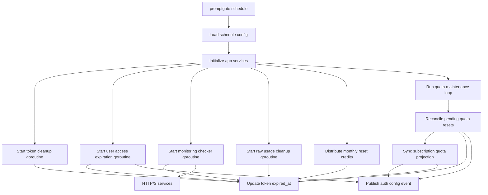

# Scheduler

The scheduler process runs recurring maintenance jobs:

```sh
promptgate --config /path/to/promptgate.yaml schedule
```

It does not expose HTTP routes. It runs until the process receives `SIGINT` or
`SIGTERM`.

## Jobs

| Job | Default interval | Purpose |
| --- | --- | --- |
| Token cleanup | `1h` | Marks stored tokens as expired when `expires_at` is in the past and `expired_at` is still empty. |
| User access expiration | `1h` | Removes app access for users whose `expires_at` has passed and revokes their active tokens. |
| Monitoring checks | `15s` scheduler tick, per-service intervals | Runs due HTTP/S checks and marks enabled services `ok` or `degraded`. |
| Raw usage cleanup | `1h` | Deletes raw proxy usage rows older than `schedule.usage_raw_retention`; dashboard KPI rows are retained. |
| Subscription quota sync | `5m` | Copies live Redis quota counters into PostgreSQL for admin/profile display and audit. |
| Quota reset distribution | `1h` | Idempotently grants the current UTC calendar month's reset credit to eligible users, up to the two-credit cap. |
| Pending quota reset reconciliation | `5m` | Retries durable reset consumptions that have not yet been applied to Redis. |

The access expiration job runs once immediately on startup and then repeats on
its interval. The token cleanup job starts its ticker and runs on the first
tick. Monitoring checks run once immediately on startup, then every `15s`; each
service is only checked when its own `intervalSeconds` has elapsed. Quota reset
distribution runs immediately and then uses its own interval. Pending-reset
reconciliation and quota projection sync share one ordered loop: both run on
startup, then reconciliation always runs before projection on each quota sync
tick.

Monthly reset distribution considers every non-expired, active human account
with role `limited`, `user`, or `admin` and an effective finite quota. This
includes an active `limited` account pre-created by an administrator before its
first SSO login. Each eligible account is processed once per UTC calendar
month. An account already at the two-credit maximum is still marked processed,
so spending a credit later in the same month does not backfill another monthly
credit.

## Runtime Flow



When user access expires, affected users are assigned role `none`, their
`expires_at` value is cleared, and their non-revoked tokens are revoked in the
same transaction. An `auth` config event is then published so proxy auth caches
move to a new version.

Monitoring checks perform an HTTP `GET` with a `5s` timeout. A service is `ok`
when the response code equals its configured `expectedStatusCode`. Any network
error, timeout, or unexpected status code marks it `degraded` after the first
failed check. The next successful check clears the degraded state. Disabled
services are not selected by the scheduler and do not appear in the user-facing
monitoring banner.

## Required Configuration

The scheduler requires `common.database.url`, `common.redis.url`,
`common.security.jwt_secret`, and `common.security.secrets_key` in the selected
YAML document.

Optional scheduler settings:

| YAML path | Default | Purpose |
| --- | --- | --- |
| `common.log.level` | `info` | `debug`, `info`, `warn`, `warning`, or `error`. |
| `common.maintenance.token_cleanup_interval` | `1h` | Interval for expired token marking. |
| `common.maintenance.user_access_expiration_interval` | `1h` | Interval for user access expiration. |
| `common.redis.cache_ttl` | `5m` | Redis TTL used by shared services. |
| `common.proxy_reload_debounce` | `250ms` | Loaded for shared configuration consistency. |
| `schedule.usage_raw_retention` | `2160h` | Retention for raw proxy usage tables used by operational metrics. |
| `schedule.usage_raw_cleanup_interval` | `1h` | Interval for raw proxy usage cleanup. |
| `schedule.subscription_quota_sync_interval` | `5m` | Interval for syncing Redis subscription quota state to PostgreSQL. |
| `common.maintenance.quota_reset_distribution_interval` | `1h` | Interval for idempotently granting the current UTC calendar month's reset credit. |

Durations use Go duration syntax such as `30m`, `1h`, or `24h`.

## Deployment Notes

- Run exactly one scheduler replica unless the deployment platform provides a
  separate locking mechanism. The current scheduler code does not implement a
  distributed job lock.
- Start the scheduler after migrations have completed.
- Mount the same protected YAML used by the API and proxy processes.
- Treat scheduler failures as operationally important because expired access
  and token state may lag until the process is restored. Monthly reset-credit
  distribution, pending reset reconciliation, and the PostgreSQL quota
  projection also stop advancing while the scheduler is unavailable.
